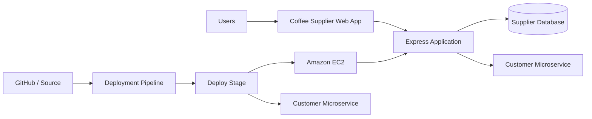

# AWS Coffee Supplier Management Project

A GitHub-ready reference implementation inspired by the AWS Skill Builder activity documented in the accompanying report.

> **Important:** This repository is a clean-room/reference implementation created for documentation and portfolio purposes. It is **not the original AWS Skill Builder lab source code**, and it does not claim to reproduce any private AWS lab repository. The AWS screenshots and temporary lab credentials from the activity should not be committed to GitHub.

## Project Overview

The project demonstrates a Coffee Supplier Management web application hosted in an AWS-style environment, with:

- Customer-facing supplier listing
- Administrator supplier management
- SQLite-backed supplier data for local reproducibility
- A separate customer microservice
- Docker support
- AWS EC2 deployment scripts
- AWS CodePipeline/CodeDeploy-compatible deployment assets
- Automated smoke tests
- Documentation matching the project report sections

The supplied activity evidence shows an AWS EC2-hosted application, supplier data operations, customer/admin views, a pipeline named `update-customer-microservice`, and a successful deployment with 100% traffic directed to the replacement version.

## Architecture



## Repository Structure

```text
.
├── src/                         # Main Coffee Supplier application
│   ├── db/                      # Database setup and seed data
│   ├── routes/                  # Web/API routes
│   └── server.js                # Express entry point
├── services/customer-service/   # Updated customer microservice
├── views/                       # EJS pages
├── public/                      # CSS/static assets
├── deploy/                      # CodeDeploy-compatible deployment files
├── scripts/                     # Local/EC2 helper scripts
├── infra/                       # Infrastructure notes and user-data script
├── docs/                        # Project/report documentation
├── Dockerfile                   # Container build
├── docker-compose.yml           # Local multi-service run
├── buildspec.yml                # CI build definition
├── appspec.yml                  # CodeDeploy deployment definition
└── package.json
```

## Local Setup

### 1. Install prerequisites

- Node.js 20+
- npm 10+

### 2. Install dependencies

```bash
npm install
cd services/customer-service && npm install && cd ../..
```

### 3. Start the customer microservice

```bash
cd services/customer-service
npm start
```

It listens on port `8081` by default.

### 4. Start the main application

In a second terminal:

```bash
npm start
```

Open:

- Customer UI: `http://localhost:8080/`
- Supplier API: `http://localhost:8080/api/suppliers`
- Admin UI: `http://localhost:8080/admin`
- Customer microservice health: `http://localhost:8081/health`

## Docker

Run both services using:

```bash
docker compose up --build
```

Then open `http://localhost:8080`.

## Testing

Run the smoke/integration tests:

```bash
npm test
```

## AWS Deployment Assets

The repository contains deployment assets that can be adapted to an AWS EC2 + CodeDeploy/CodePipeline setup:

- `buildspec.yml` – dependency installation, tests, and packaging
- `appspec.yml` – deployment instructions
- `deploy/scripts/` – stop/start/validate hooks
- `infra/ec2-user-data.sh` – example EC2 bootstrap script
- `docs/AWS_DEPLOYMENT.md` – deployment guidance

The deployment assets intentionally use placeholders rather than hard-coded account IDs, regions, IP addresses, IAM credentials, or temporary lab tokens.

## Security Notes

Never commit AWS access keys, secret keys, session tokens, temporary AWS Skill Builder/Vocareum URLs, or `.env` files. Use IAM roles and environment variables instead.

## Report Mapping

- `docs/PROJECT_SUMMARY.md`
- `docs/PROBLEM_STATEMENT.md`
- `docs/ARCHITECTURE.md`
- `docs/IMPLEMENTATION_STEPS.md`
- `docs/OUTPUT.md`
- `docs/CONCLUSION.md`

## GitHub Upload

After testing locally:

```bash
git init
git add .
git commit -m "Initial coffee supplier AWS project"
git branch -M main
git remote add origin https://github.com/<your-username>/aws-coffee-supplier-project.git
git push -u origin main
```
